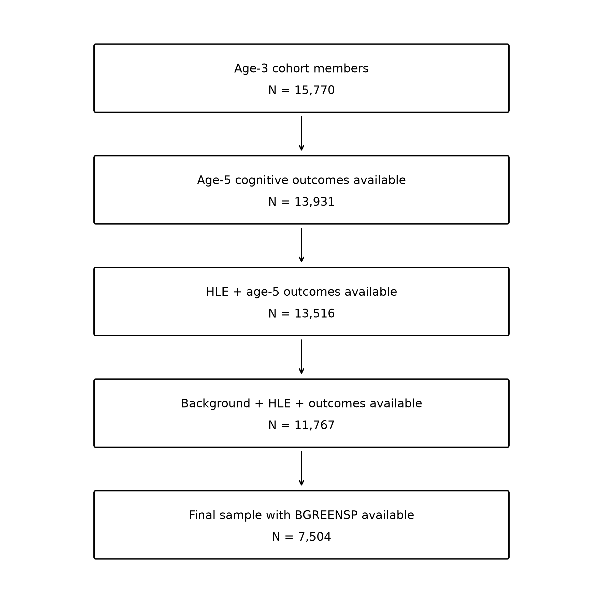

Neighbourhood Green-Space Exposure and Childhood Cognitive Performance

MSc Data Science Dissertation | University of Surrey

This project investigates whether neighbourhood green-space exposure at age 3 is associated with cognitive performance at age 5, after accounting for socioeconomic background and the Home Learning Environment (HLE).

The analysis uses longitudinal secondary data from the UK Millennium Cohort Study (MCS) and examines two cognitive outcomes separately: Naming Vocabulary and Pattern Construction.

Research Question

Is neighbourhood green-space exposure at age 3 associated with cognitive performance at age 5 after accounting for socioeconomic background and the Home Learning Environment?

The project also examined whether the association differed between verbal and non-verbal cognitive outcomes and whether the findings remained consistent after geographical and survey-design adjustments.
## Study Sample

The analytical sample was constructed by progressively combining the required age-3 background and Home Learning Environment measures with age-5 cognitive outcomes and the primary neighbourhood green-space exposure measure.

*Figure 1. Sample selection for the primary analytical sample.*

What I Did

The project involved working with multiple longitudinal and geographical datasets from the Millennium Cohort Study.

The main stages included:

* identifying and extracting relevant variables across different MCS datasets and survey sweeps
* cleaning, recoding and integrating data from multiple sources
* linking age-3 environmental and family measures with age-5 cognitive outcomes
* constructing socioeconomic and Home Learning Environment variables
* investigating missing data and constructing the final complete-case analytical sample
* carrying out exploratory data analysis
* developing hierarchical ordinary least-squares regression models
* performing regression diagnostics
* testing the robustness of the results using alternative standard errors, family clustering, an alternative green-space measure, geographical adjustment and MCS survey-design specifications
* interpreting the results while considering the limitations of observational data

The final primary analytical sample contained 7,504 children.

Methods

The analytical workflow was organised using an adapted CRISP-DM framework.

The main analytical methods included:

* longitudinal data preparation and linkage
* feature construction
* exploratory data analysis
* hierarchical OLS regression
* model diagnostics
* HC3 heteroskedasticity-robust standard errors
* family-clustered standard errors
* sensitivity analysis using an alternative green-space measure
* geographical adjustment
* complex survey-design adjustment
* robustness analysis

Key Findings

In the primary adjusted analysis, greater neighbourhood green-space exposure was associated with higher Naming Vocabulary performance at age 5.

The corresponding association with Pattern Construction was small and did not meet the conventional threshold for statistical significance.

The Naming Vocabulary association remained relatively stable under several robustness checks but became substantially weaker after geographical and survey-design adjustment.

The findings therefore do not suggest a simple or uniform relationship between neighbourhood green space and childhood cognitive performance. Instead, the results indicate that the observed association depends on the cognitive outcome examined and the analytical context considered.

As this was an observational study, the findings are interpreted as associations rather than causal effects.

Technologies

* Python
* Jupyter Notebook
* pandas
* NumPy
* statsmodels
* SciPy
* Matplotlib
* pyreadstat

Repository Contents

01_dissertation_analysis_clean_annotated.ipynb

Main analysis notebook containing data preparation, variable construction, exploratory analysis, statistical modelling and robustness checks.

02_dissertation_results_tables.ipynb

Produces the final results and tables used in the dissertation.

Data Availability

This project uses data from the UK Millennium Cohort Study (MCS) accessed through the UK Data Service.

The original MCS data and participant-level derived datasets are not included in this repository because access and use are subject to the relevant UK Data Service licensing conditions.

Researchers with appropriate authorised access to the required MCS datasets can use the notebooks to reproduce the analytical workflow after placing the required source data in the expected local data structure.

## Reproducibility

The analysis notebooks are provided to document the complete analytical workflow used for this project.

The Millennium Cohort Study (MCS) data are not included in this repository because access is governed by the UK Data Service licence. Researchers with appropriate access can obtain the required MCS datasets through the UK Data Service.

To reproduce the analysis:

1. Clone or download this repository.
2. Create a folder named `MCS_DATA` in the project directory.
3. Place the authorised MCS source data files required by the analysis inside `MCS_DATA`.
4. Run `01_dissertation_analysis_clean_annotated.ipynb` to perform the main data preparation and statistical analysis.
5. Run `02_dissertation_results_tables.ipynb` after the first notebook to reproduce the final results tables.

The first notebook generates the derived analytical dataset used by the second notebook. Participant-level source and derived data are intentionally excluded from the public repository.

Dissertation

This project was completed as part of the MSc Data Science programme at the University of Surrey.

Dissertation title:
Neighbourhood Green-Space Exposure at Age 3 and Cognitive Performance at Age 5: A Longitudinal Analysis of the UK Millennium Cohort Study

Academic year: 2025–2026

Author

Syeda Fizza Raza
MSc Data Science, University of Surrey
